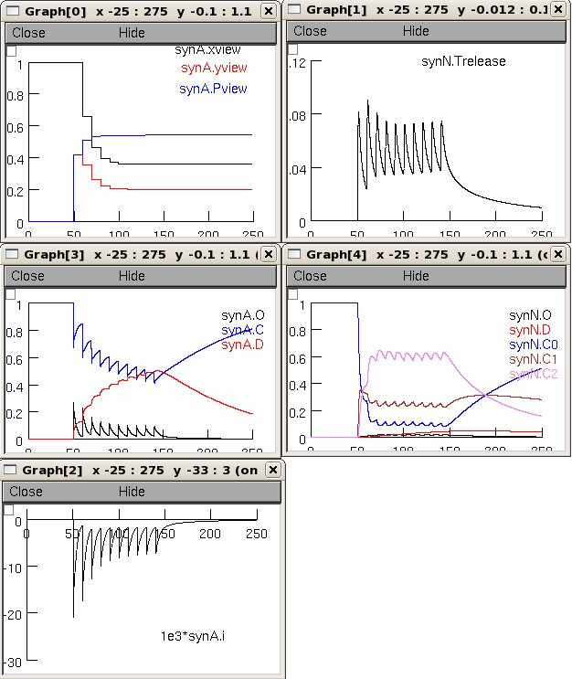

The files refer to the model published in the paper:

"LTP regulates burst initiation and frequency at mossy fiber-granule  
cell synapses of rat cerebellum: experimental observations and  
theoretical predictions." Nieus T, Sola E, Mapelli J, Saftenku E,  
Rossi P, D'Angelo E.  *J Neurophysiol.* 2006 Feb;95(2):686-99

These files were contributed by Thierry Nieus.

The scripts reproduce Figure 7 of the paper. The control condition,  
release probability (U) = 0.416, is set by default. To reproduce the  
right panel of the figure set release probability, the variable "MF  
to GRC synapse Prel", equal to 0.6.

## To run:

Either auto-launch from ModelDB (after NEURON, available from  
[http://www.neuron.yale.edu](http://www.neuron.yale.edu), is installed) or

1. download and extract the files.  
2. Compile the mod files as usual on your platform (run mknrndll under  
windows, execute nrnivmodl in the extracted directory under Linux, or  
drag and drop the extracted folder onto the mknrndll icon under Mac OS  
X).  
3. Then start mosinit.hoc (double click on mosinit.hoc in Windows,  
type "nrngui mosinit.hoc" in Linux, or drag and drop the mosinit.hoc  
file onto the nrngui icon in Mac OS X).

Once the simulation is running press the Init & Run button. The  
following panels relevant to the left panel of Figure 7 will be  
generated:

---

2025-06-02: Converted README to Markdown.